# Лаба 1. ~~Вскрываем~~ Изучаем Docker

## Оглавление

0. [Создаём тестовый сервис](#создаём-тестовый-сервис)
1. [Запускаемся напрямую](#запускаемся-напрямую)
2. [Изолируем через namespaces](#изолируем-через-namespaces)
3. [Ограничиваем ресурсы через cgroups](#ограничиваем-ресурсы-через-cgroups)
4. [Ограничиваем права через capabilities и профиль seccomp](#ограничиваем-права-через-capabilities-и-профиль-seccomps)
5. [Собираем свой Docker из того, что есть у каждого под рукой](#собираем-свой-docker-из-того-что-есть-у-каждого-под-рукой)
6. [Образы, multistage и тома Docker](#образы-multistage-и-тома-docker)
7. [gVisor и чем он хорош](#gvisor-и-чем-он-хорош)
8. [Наблюдаем за подопытным](#наблюдаем-за-подопытным)

## Предисловие

Лаба будет выполняться на виртуальной машине с Debian 13. Сервис будет собираться на Go 1.27.1.

Все скрипты исполняются относительно корня папки с лабой.

## Создаём тестовый сервис

Используя LLM сгенерируем сервис по требованиям на языке программирования Go. Исходный код сервиса представлен в [src/api/main.go](src/api/main.go). 

## Запускаемся напрямую

Напишем скрипт на bash, который соберёт и запустит сервис напрямую, отдаст ответ от health endpoint'а и покажет выводы ps и pgrep. Исходный код скрипта представлен в [src/scripts/direct-run.sh](src/scripts/direct-run.sh). Получим выводы от скрипта, представленные на скрине. Как видно, сервис успешно запустился без изоляции, мы смогли получить его PID и успешно "убить" его по нему.

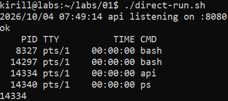

## Изолируем через namespaces

Добавим рамок нашему сервису через изоляцию с использованием namespaces. Для этого используем команду `unshare` с параметрами `--user --map-root-user --pid --mount --net --uts --ipc --fork --mount-proc`. 

Отметим, за что отвечает каждый namespace:
- user - изолируем пользователей, их группы и capabilities сервиса;
- mount - изолируем список точек монтирования сервиса;
- net - изолируем сетевой стек сервиса (сетевые адаптеры, таблица маршрутизации, правила брандмауэра и прочие части стека);
- uts - изолируем имя хоста и доменное имя сервиса;
- ipc - изолируем межпроцессные взаимодействия (очереди сообщений, семафоры и shared memory) сервиса;
- pid - изолируем пространство идентификаторов процессов сервиса.

Также используются служебные флаги команды `--map-root-user` для отображения текущего локального пользователя в UID 0 окружения сервиса, `--fork` для системного вызова fork(), который создаст процесс с PID 0 в окружении сервиса и `--mount-proc` для создания новой procfs в окружении сервиса.

Для тестирования работы unshare напишем скрипт на bash, который выведет UID текущего пользователя, настроит окружение и запустит в нём тестовый скрипт, который включит loopback интерфейс окружения, проверит его с помощью ping, сменит hostname, выведет имя пользователя окружения и его UID, ps и hostname, а затем запустит [src/scripts/direct-run.sh](src/scripts/direct-run.sh). Исходный код скрипта представлен в [src/scripts/namespaces.sh](src/scripts/namespaces.sh), исходный код тестового скрипта представлен в [src/scripts/test-namespaces.sh](src/scripts/test-namespaces.sh). Получим выводы от скрипта, представленные на скрине. Как видно, наше окружение, изолированное только namespaces успешно работает. 

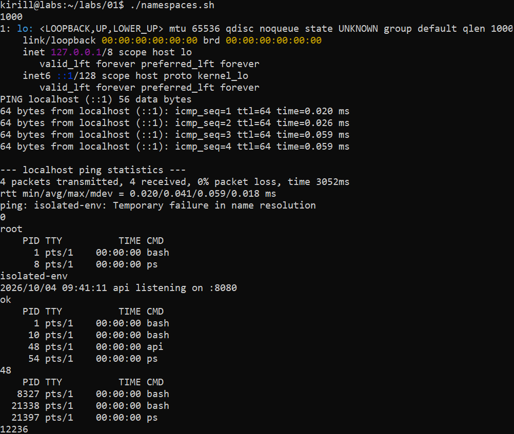

Но сейчас мы не изолированы от правки файлов в ФС хоста от запускающего пользователя, не ограничены по ресурсам, а также не ограничены в системных вызовах и capabilities.

## Ограничиваем ресурсы через cgroups

Чтобы наш сервис не смог забрать себе все ресурсы хоста навесим на него ограничения через cgroups. Для того, чтобы создавать cgroups для приложений необходимы root-права. Напишем скрипт, который создаст cgroup, запустит скрипт отслеживания троттлингов и OOM и поместит наш сервис в cgroup и проверяет то, как живёт cgroup при бомбёжке форками процессов. Исходный код скрипта представлен в [src/scripts/cgroups.sh](src/scripts/cgroups.sh), исходный код монитора представлен в [src/scripts/monitor.sh](src/scripts/monitor.sh). На выходе получим данные, которые представлены на скриншоте.

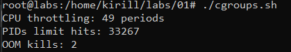

Как видно, после того, как мы загрузили поток, периодов троттлинга стало больше нуля, также после мы поймали OOM, так как попытались аллоцировать 256 МБ памяти, когда в cgroup было ограничение на 128 МБ, счётчик превышения PID'ов также был больше нуля после теста форк-бомбой. То есть мы успешно ограничили сервис по ресурсам.

## Ограничиваем права через capabilities и профиль seccomp

Теперь нужно ограничить права на системные вызовы и привилегированные операции. Для этого напишем небольшой лаунчер на c, который будет сбрасывать capabilities и через secconp запретит выполнение системного вызова getppid. Исходный код лаунчера представлен в [src/cap_seccomp_launcher.c](src/cap_seccomp_launcher.c). Исходный код скрипта для проверки на Python представлен в [src/check_cap_seccomp.py](src/check_cap_seccomp.py). Компиляция лаунчера производится в помощью команды `gcc src/cap_seccomp_launcher.c -o bin/launcher -lcap -lseccomp`. Запустить тестовый скрипт с помощью лаунчера можно командой `bin/launcher python3 src/check_cap_seccomp.py`. В данном части мы забираем у исполняемого файла capabilities для выполнения привилегированных действий, но не возможность повысить их, а также запрещаем определённый системный вызов, что ограничивает возможности даже при выполнении от root. Результаты выполнения тестового скрипта можно увидеть на скриншоте.

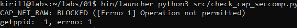

При применении на исполняемом файле api эффект будет аналогичен тому, что было при применении на интерпретаторе Python.

## Собираем свой Docker из того, что есть у каждого под рукой

Итак, приступим к сборке нашего аналога Docker. Для начала определим последовательность операций:
1. Создание cgroup и установка лимитов;
2. Создание subshell и помещение его PID в cgroup;
3. Вызов unshare с флагами namespace'ов и вызовом ещё одного subshell;
4. Вызов из второго subshell лаунчера для ограничения capabilities и syscall;
5. Вызов сервиса лаунчером.

Данная последовательность работала бы в идеальном мире, но мы с вами живём в реальности, где только root может создавать sub cgroup на уровне корня. Поэтому для работы нашего скрипта будем использовать допущение, что скрипт ВСЕГДА запускается через sudo непривилегированным пользователем. Потому в начале нашего скрипта добавим проверку, что переменные окружения SUDO_UID и SUDO_GID не пустые, иначе вернём ошибку запуска скрипта. После создания cgroup добавим функцию для удаление cgroup при завершении работы скрипта. До момента запуска subshell наша предыдущая схема не меняется, во время него передаём subshell переменные с cgroup path, UID и GID запустившего. Так можно гарантировать то, что целевой сервис будет запущен от имени непривилегированного пользователя на хосте. После этого всё идёт по схеме запуска.

В качестве проверки попробуем запустить сервис в окружении и послать к нему запрос с помощью nsenter. Команда для проверки (запускать в другом терминале)
```bash
PID=$(pgrep -x api | head -n 1)
nsenter -t "$PID" --net curl http://127.0.0.1:8080/health
```

Результат проверки представлен на скриншоте ниже.

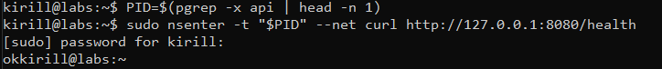

Запускать Docker будем с помощью команды `docker run --rm --name api-docker --cpus=0.5 --memory=128m --memory-swap=128m --pids-limit=64 --network=none api:latest`, которая повторяет наш набор лимитов там, где это возможно.
Для проверки также используем nsenter, так как в scratch образе не предусмотрены консольные инструменты.
```bash
PID=$(docker inspect -f '{{.State.Pid}}' api-docker)
nsenter -t "$PID" --net curl http://127.0.0.1:8080/health
```

Результат проверки запуска в настоящем Docker показан на скриншоте.
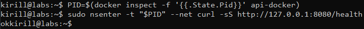

Сравним наш скрипт с Docker: 
- в Docker при маппинге пользователей по умолчанию root контейнера = root хоста, у нас тот кто запустил скрипт через sudo;
- Capabilities в Docker снимаются без возможности повышения и выдаются по необходимости, у нас есть возможность повышения;
- Seccomp в Docker снимает целый список различных syscall, у нас только один getppid;
- Механизм работы с cgroups идентичен;
- Ограничения по namespace'ам в Docker делаются напрямую через syscall, у нас через обёртку.

## Образы, multistage и тома Docker

Напишем Dockerfile для singlestage сборки. Его исходный код представлен в [src/Dockerfile](src/Dockerfile). Соберём образ через `docker image build --progress=plain -t api .`. Выведем `docker images api`.

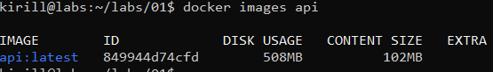

Как видим, образ занимает 508 мегабайт памяти.

Соберём multistage вариант, исходный код Dockerfile которого можно найти в [src/Dockerfile.multistage](src/Dockerfile.multistage), и выведем `docker images api`.

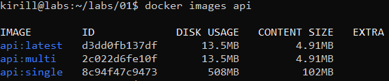

Сравнив размеры можно заметить, что multistage образ весит всего 13.5 мегабайт памяти, что в 37.6 раз меньше, чем singlestage образ.

Сравним количество слоёв в single и multi образах

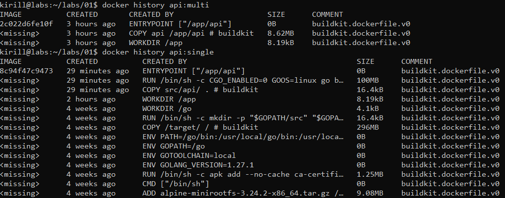

По скриншоту видно, что multi образ содержит 2 слоя против 8 слоёв в single образе.

Сравним сборку двух образов. Заметим, что у них используется кеш там, где слои не менялись, например на сборке бинарника сервиса.
```console
kirill@labs:~/labs/01$ docker image build --progress=plain -f Dockerfile -t api:single .
#0 building with "default" instance using docker driver

#1 [internal] load build definition from Dockerfile
#1 transferring dockerfile: 168B done
#1 DONE 0.0s

#2 [internal] load metadata for docker.io/library/golang:1.27.1-alpine
#2 DONE 1.1s

#3 [internal] load .dockerignore
#3 transferring context: 2B done
#3 DONE 0.0s

#4 [1/4] FROM docker.io/library/golang:1.27.1-alpine@sha256:8a5910f31396cd4d89662f56c68b3ae31d374308270a1c3bd96672ee5ed43414
#4 resolve docker.io/library/golang:1.27.1-alpine@sha256:8a5910f31396cd4d89662f56c68b3ae31d374308270a1c3bd96672ee5ed43414 0.0s done
#4 DONE 0.0s

#5 [internal] load build context
#5 transferring context: 120B done
#5 DONE 0.0s

#6 [2/4] WORKDIR /app
#6 CACHED

#7 [3/4] COPY src/api/ .
#7 CACHED

#8 [4/4] RUN CGO_ENABLED=0 GOOS=linux go build -o /app/api
#8 CACHED

#9 exporting to image
#9 exporting layers done
#9 exporting manifest sha256:b70c8d88ea6cfe0d28ef2c763adbcdb583d94685f3e7440b3e81e8cb6e39ed47 done
#9 exporting config sha256:502d5cb18dae7f6de15ac5aa9513bac9c248135464e7705ff26d8f74debd89ef done
#9 exporting attestation manifest sha256:f53ab8c54d93588d6c6d237c254b8a36e09ba74e4c278a26f918939c134eb475 0.0s done
#9 exporting manifest list sha256:96c3eb1b62a01df3a70a2a8fe00138dd155c323191ceeb975d9029b97d297f41
#9 exporting manifest list sha256:96c3eb1b62a01df3a70a2a8fe00138dd155c323191ceeb975d9029b97d297f41 0.0s done
#9 naming to docker.io/library/api:single done
#9 unpacking to docker.io/library/api:single
#9 unpacking to docker.io/library/api:single 2.4s done
#9 DONE 2.5s
kirill@labs:~/labs/01$ docker image build --progress=plain -f Dockerfile.multistage -t api:multi .
#0 building with "default" instance using docker driver

#1 [internal] load build definition from Dockerfile.multistage
#1 DONE 0.0s

#1 [internal] load build definition from Dockerfile.multistage
#1 transferring dockerfile:
#1 transferring dockerfile: 249B done
#1 DONE 1.8s

#2 [internal] load metadata for docker.io/library/golang:1.27.1-alpine
#2 DONE 15.4s

#3 [internal] load .dockerignore
#3 transferring context: 2B done
#3 DONE 0.0s

#4 [stage-1 1/2] WORKDIR /app
#4 DONE 0.0s

#5 [builder 1/4] FROM docker.io/library/golang:1.27.1-alpine@sha256:8a5910f31396cd4d89662f56c68b3ae31d374308270a1c3bd96672ee5ed43414
#5 resolve docker.io/library/golang:1.27.1-alpine@sha256:8a5910f31396cd4d89662f56c68b3ae31d374308270a1c3bd96672ee5ed43414 0.0s done
#5 DONE 0.1s

#6 [internal] load build context
#6 transferring context: 120B done
#6 DONE 0.0s

#7 [builder 2/4] WORKDIR /build
#7 CACHED

#8 [builder 3/4] COPY src/api/ .
#8 CACHED

#9 [builder 4/4] RUN CGO_ENABLED=0 GOOS=linux go build -o /api
#9 CACHED

#10 [stage-1 2/2] COPY --from=builder api /app/api
#10 CACHED

#11 exporting to image
#11 exporting layers done
#11 exporting manifest sha256:b60c3ee8ce54ed4addd8a742c5dbd22464d973e7f67e30856e47235b1ea7954b 0.0s done
#11 exporting config sha256:4e4bc8083449beafff2c88e54bcf62bb9436e79859a53fd79c46b7b256c4be2a done
#11 exporting attestation manifest sha256:191d24e6781544b6dceb02446ff566492d4d571ed5f356a5bfc9bf17191e1036 0.0s done
#11 exporting manifest list sha256:c22ea1a5043d3a66f04e6d62ae81d3d7d15ddc5d129328100c4b50ffeafdbe81 0.0s done
#11 naming to docker.io/library/api:multi
#11 naming to docker.io/library/api:multi done
#11 unpacking to docker.io/library/api:multi 0.1s done
#11 DONE 0.2s
```

Перейдём к томам. Они нужны для постоянного хранения данных, независимо от жизненного цикла контейнеров. 

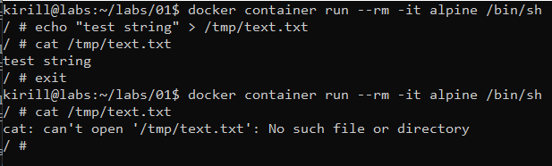

По скриншоту видно, что файл не сохранился между пересозданиями контейнера. Поэтому добавим магии томов для исправления ситуации.

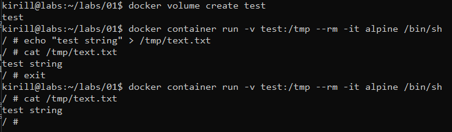

Скриншот показывает, что файл спокойно пережил перезапуск контейнера и был прочитан.


## gVisor и чем он хорош

Итак, пора поднять градус изоляции и перехватывать syscalls через gVisor. Для этого устанавливаем его и репозитория google для debian и регистрируем в качестве райнтайма для docker'а. Для этого исполняем следующий набор команд:
```console
sudo apt-get update
sudo apt-get install -y ca-certificates curl gnupg
curl -fsSL https://gvisor.dev/archive.key |
  sudo gpg --dearmor -o /usr/share/keyrings/gvisor-archive-keyring.gpg
echo "deb [arch=$(dpkg --print-architecture) signed-by=/usr/share/keyrings/gvisor-archive-keyring.gpg] https://storage.googleapis.com/gvisor/releases release main" |
  sudo tee /etc/apt/sources.list.d/gvisor.list
sudo apt-get update
sudo apt-get install -y runsc
sudo runsc install
sudo systemctl restart docker
```

Для запуска под runsc рантаймом нужно добавить флаг `--runtime=<имя рантайма>`, применим такие команды для запуска и проверки того, что райнтайм подменился.
```console
docker run -d \
  --name api-gvisor \
  --runtime=runsc \
  -p 8080:8080 \
  api:multi
docker inspect api-gvisor \
  --format 'Runtime: {{.HostConfig.Runtime}}, Status: {{.State.Status}}'
curl -i http://127.0.0.1:8080/health
```

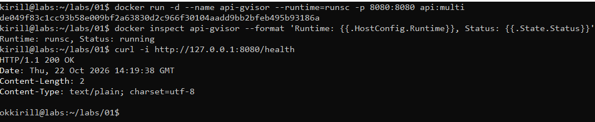

Говоря о вопросах: gVisor перехватывает системные вызовы и частично реализует их, либо передаёт их хостовому ядру в ограниченном порядке. У обычного контейнера с хостом остаётся общее ядро и системные вызовы к нему, так как всякая контейнеризация использует в своей основе механизмы ядра хоста, как видно по данной лабе.

Такие дела.

## Наблюдаем за подопытным

Составим `compose.yaml` через который будем поднимать мониторинг этой лабы (считаю, что сейчас не имеет смысла поднимать minikube или k3d, займёмся этим в следующей лабе). Исходный код доступен в [src/compose.yaml](src/compose.yaml), подключение Prometheus
к cAdvisor прописано в [src/prometheus.yml](src/prometheus.yml).

Посмотрим на дашборд в Grafana, который получился. На трёх его графиках представлены использование CPU (относительно потока), процент периодов троттлинга относительно периода общего использования процессора и процент использования выделенной памяти.

Сам дашборд представлен на скриншоте.

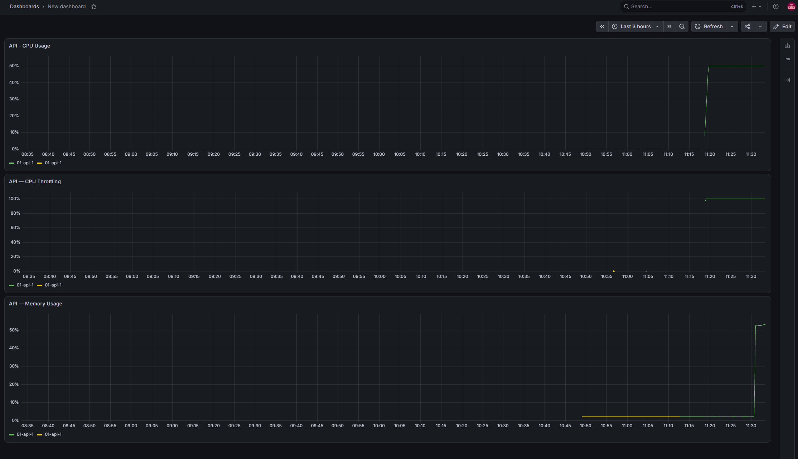

На этом моменте лабы нужно написать метрики под алерты, поэтмоу этим и займёмся.

Первая метрика алерта - использование больше 90% памяти в течение более чем двух минут, может потенциально грозить OOM'ом
```
100 *
container_memory_working_set_bytes{
  name="01-api-1"
}
/
container_spec_memory_limit_bytes{
  name="01-api-1"
} > 90
```

Вторая метрика алерта - использование больше 90% памяти в течение более чем пяти минут, грозит нехваткой CPU при дальнейшей работе и увеличении нагрузок
```
100 *
rate(container_cpu_usage_seconds_total{
  name="01-api-1",
  cpu="total"
}[1m])
/ 0.5 > 90
```

Третья метрика алерта - больше 50% троттлинга в течение более чем пяти минут, грозит увеличением задержек сервиса
```
100 *
rate(container_cpu_cfs_throttled_periods_total{name="01-api-1"}[1m])
/
rate(container_cpu_cfs_periods_total{name="01-api-1"}[1m]) > 50
```

Вроде бы всё написал. Считаю данную лабу законченной.