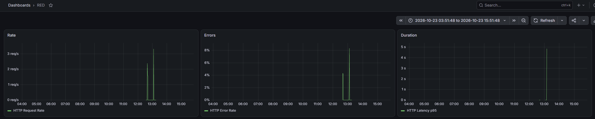
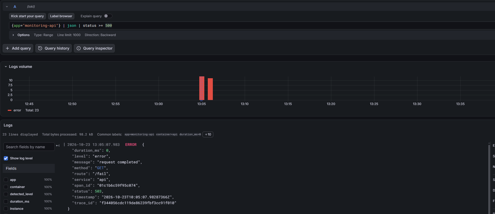
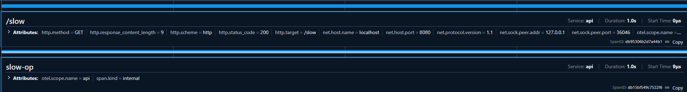
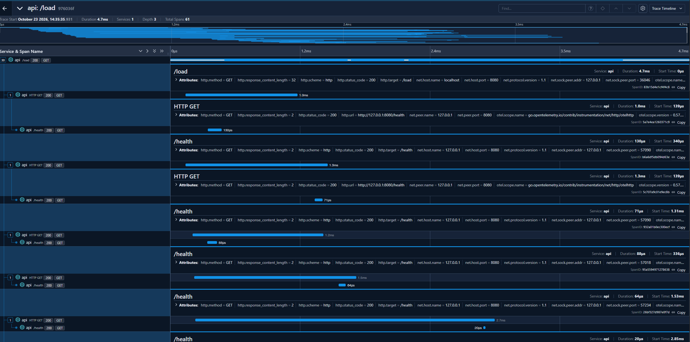
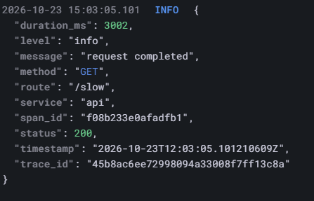
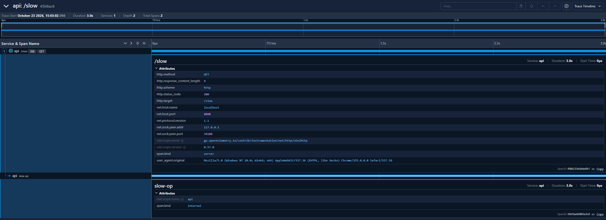

# Лаба 2. А как следить-то?

## Оглавление

0. [Создаём тестовый сервис](#создаём-тестовый-сервис)
1. [Собираем метрики](#собираем-метрики)
2. [Собираем логи](#собираем-логи)
3. [Смотрим трейсы](#смотрим-трейсы)
4. [Настраиваем алерты](#настраиваем-алерты)


### Инфа о том, как это потом использовать в других лабах

Репы с Helm чартами:
- prometheus-community https://prometheus-community.github.io/helm-charts
- grafana https://grafana.github.io/helm-charts
- jaegertracing https://jaegertracing.github.io/helm-charts

Команда для добавления репы `helm repo add <name> <repo>`
Команда для обновления списков реп `helm repo update`

Сами чарты, которые используем в лабе:
- prometheus-community/kube-prometheus-stack
- grafana/loki
- grafana/alloy
- jaegertracing/jaeger

Типовая команда установки нового чарта
```console
helm upgrade --install <name> <repo>/<chart-name> \
  -n <namespace> \
  -f <name>-values.yaml \
  --wait \
  --timeout 5m
```

Пробрасываем через `kubectl port-forward`

## Создаём тестовый сервис

В качестве движка для k8s будем использовать minikube.

Используя LLM сгенерируем сервис по требованиям на языке программирования Go. Исходный код сервиса представлен в [src/api/main.go](src/api/main.go). 

Также напишем Helm Chart для запуска сервиса. Его исходные коды представлены в [src/api/helm](src/api/helm).

## Собираем метрики

ATTENTION: весь мониторинг работает в namespace monitoring, сервис живёт в namespace default. В явном виде namespace не прописаны.

Начнём со сбора метрик. Для этого развернём kube-prometheus-stack, который включает в себя Grafana, Prometheus и Alertmanager. Для работы с Prometheus настроен ServiceMonitor, исходный код шаблона которого находится в [src/api/helm/templates/servicemonitor.yaml](src/api/helm/templates/servicemonitor.yaml).

Собран дашборд по RED, который строит графики по следующим метрикам:
- sum(rate(http_requests_total{job="monitoring-api"}[2m])) - количество запросов за последние две минуты
- 100 * sum(rate(http_requests_total{job="monitoring-api",status=~"5.."}[2m]))/clamp_min(sum(rate(http_requests_total{job="monitoring-api"}[2m])), 0.000001) - процент количества серверных ошибок относительно всех запросов за последние две минуты
- histogram_quantile(0.95, sum by (le) (rate(http_request_duration_seconds_bucket{job="monitoring-api"}[5m]))) - гистограмма среднего времени ответов на запросы за последние пять минут

Скриншот дашборда приведен ниже, как видно графики строятся.



## Собираем логи

Теперь, когда у нас есть Grafana, нужно прикрутить к ней Loki, а к нему агент сбора логов Alloy. 

Параметры для развёртывания Helm Chart с Loki находятся в [src/helm/loki-values.yaml](src/helm/loki-values.yaml), для Helm Chart с Alloy - [src/helm/alloy-values.yaml](src/helm/alloy-values.yaml).

Скриншот с пойманной ошибкой находится ниже.



## Смотрим трейсы

Теперь поднимем Jaeger и подключим к нему наш сервис. Параметры для развёртывания находятся в [src/helm/jaeger-values.yaml](src/helm/jaeger-values.yaml). Для работы с Jaeger сервису необходимо передать переменную окружения OTEL_EXPORTER_OTLP_ENDPOINT.
В сервисе изначально было предусмотрена поддержка OpenTelemetry, все запросы имеют trace_id и span_id. Посмотрим на /slow в трейсах.



Видно, что у него есть второй span, который забирает на себя почти всё время выполнения.

Посмотрим на /fail в трейсах.


Видно, что он имеет exception event внутри себя.

Посмотрим на /load в трейсах.



Видно, что он вызывает множество дополнительных событий как клиент.

Возьмём trace_id slow запроса из Grafana и найдём его в Jaeger. 

На скриншотах ниже представлены результаты сопоставления.






## Настраиваем алерты

