# Лаба 4. Сыграем в голодные игры?

Задание: [lab.md](./lab.md).

Продолжаем чарт `shop` из третьей лабы. Критический путь — заказ (`api → postgres`). `batch` — «ночная аналитика», под давлением ей можно пожертвовать. Кластер kind на **две ноды**, всё настраивается через Helm, не разовыми `kubectl patch`.

```text
batch/            # жертвенный сервис
charts/shop/      # чарт
kind-config.yaml
screenshots/
```

## Часть 0 — batch

Сгенерировал простой Go-сервис: в цикле жрёт CPU и память, пользы ноль. Параметры через env (`CPU_WORKERS`, `MEMORY_MIB`). Образ `shop/batch:v1`, шаблон в чарте.

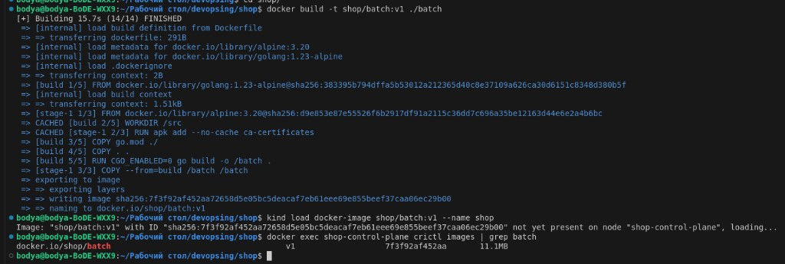

## Часть 1 — Как разносить реплики

В `values.yaml` сделал переключатель между `podAntiAffinity` и `topologySpreadConstraints`, логика в хелпере `shop.placement`.

**podAntiAffinity** (required) — запрет: два пода с одной меткой не могут стоять на одной ноде. На двух нодах и трёх репликах третья навсегда уйдёт в `Pending`.

**topologySpreadConstraints** — не запрет, а «держи перекос не больше maxSkew». При `maxSkew: 1` три реплики могут встать как 2+1 и все остаться Running.

Я взял **topologySpreadConstraints**: критическому пути важнее, чтобы все реплики жили, а не висели в Pending из‑за жёсткого anti-affinity на тесной площадке. `whenUnsatisfiable: DoNotSchedule` — если разнести нельзя честно, лучше не сажать всех в кучу.

## Часть 2 — Тесная площадка

Поднял kind на control-plane + worker. С control-plane снял taint `NoSchedule` (в `kind-config.yaml` — `taints: []`), иначе все поды сидели бы только на worker и разнесение было бы нечем показать.

Добавил `batch` в чарт с нормальными requests/limits — Kyverno из лабы 3 без исключений. После `helm upgrade` всё Running.

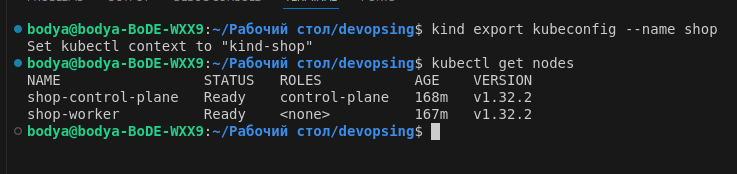

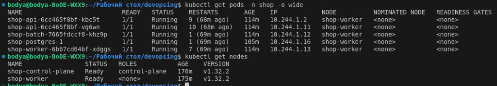

## Часть 3 — Реальные числа вместо угадывания

Догадка в чарте была с потолка: api `50m/64Mi`, worker `25m/32Mi`, postgres `100m/256Mi`.

Прогнал `hey` по `POST /order`, дал Prometheus накопить метрики, потом `krr`:

```bash
docker run --rm --network host \
  -v "$HOME/.kube/config:/root/.kube/config:ro" \
  robustadev/krr:v1.31.1 \
  python krr.py simple -n shop \
  -p http://127.0.0.1:9090 \
  --history-duration 1 \
  --points-required 30
```

Нюансы по дороге: `history-duration` — это часы, минимум 1 (с `0.5` падает валидация). Дефолтные 100 точек на окне в час дают «Need data», поэтому `--points-required 30`.

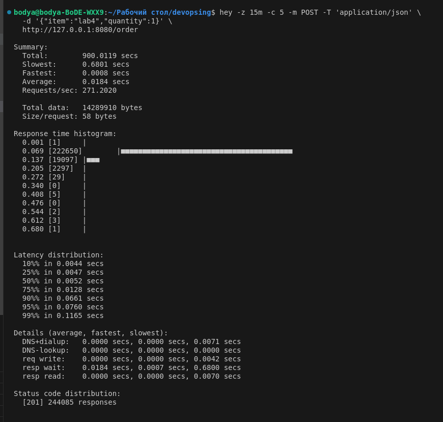

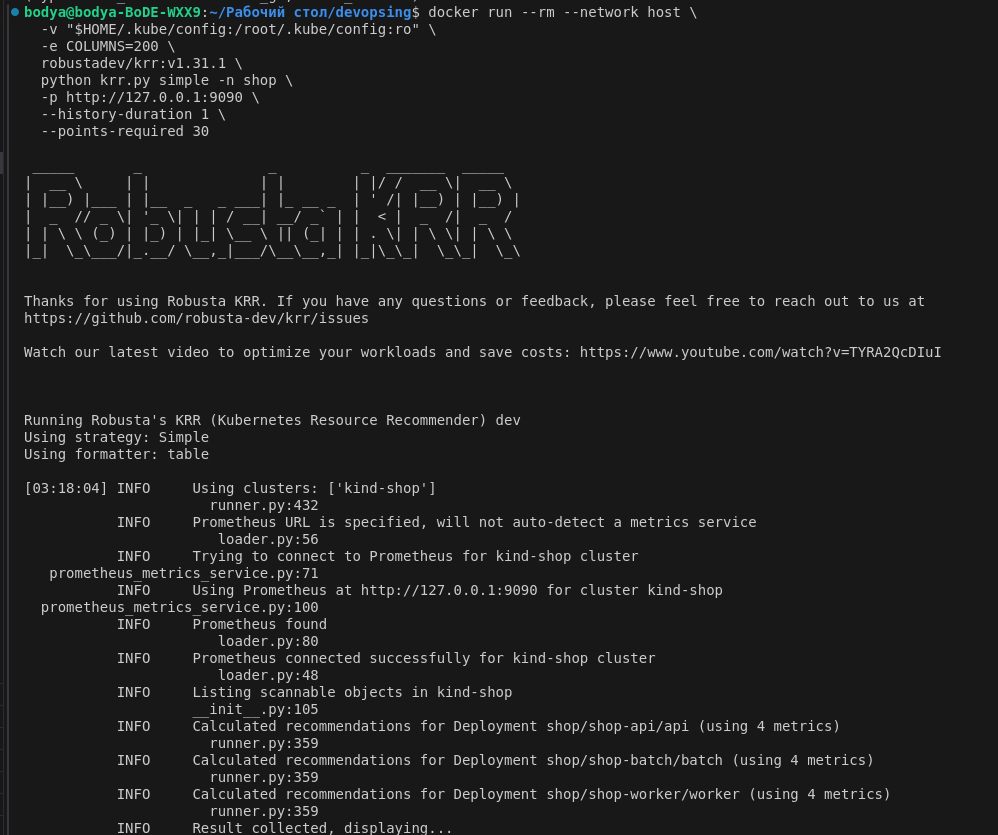

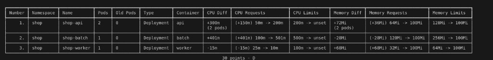

| Сервис | Было (догадка) | Что сказал krr |
| --- | --- | --- |
| api | 50m / 64Mi → 200m / 128Mi | request **200m / 100Mi**, CPU limit пустой |
| worker | 25m / 32Mi → 100m / 64Mi | **10m / 100Mi** |
| batch | 100m / 128Mi → 500m / 256Mi | ~501m / 100Mi — **не трогал** |
| postgres | 100m / 256Mi → 500m / 512Mi | по Prometheus ~**364m / 140Mi** (CNPG Cluster krr не видит) |

Почему так разошлось: api под нагрузкой ест заметно больше idle; worker почти ничего не делает, а `10m`/`100Mi` — просто пол krr. У batch цикл упирается в свой CPU limit, поэтому рекомендация ~501m — для жертвы это ожидаемо, в критический путь не тащил.

Пустой CPU limit из krr в кластер не прошёл: Kyverno требует и `limits.cpu`, и `limits.memory`.

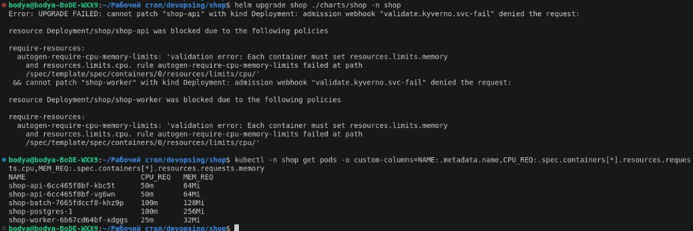

В чарт записал requests/mem из krr, CPU limit поставил примерно 2× request. Потом в части 5 для Guaranteed выровнял requests=limits.

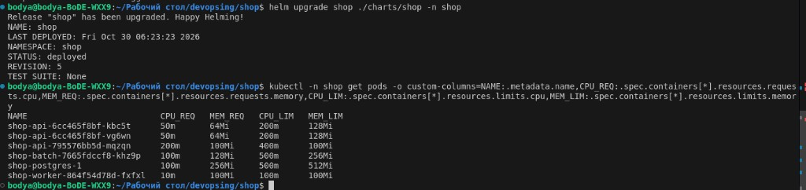

## Часть 4 — Разнести api

Включил `spreading.enabled: true` — на api повесились topologySpreadConstraints по `kubernetes.io/hostname`.

После обычного rolling update обе новые реплики иногда оказывались на одной ноде (skew ещё считал старые поды). Сделал чистый reschedule: scale в 0 и обратно в 2. Итог — по одной реплике на control-plane и на worker.

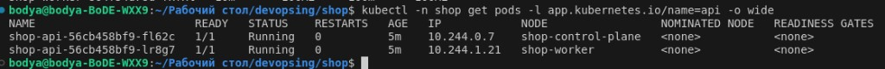

Если одна нода умрёт, вторая реплика api останется — заказ не обнулится целиком. Нагрузка вырастет, но путь живой. На двух kind-нодах это маленькая модель «разнести по зонам».

## Часть 5 — Приоритеты и гарантии

Три разные штуки, их легко перепутать.

**QoS** считает сам Kubernetes. `requests == limits` по CPU и памяти → Guaranteed. Запрос ниже лимита → Burstable. Под давлением по памяти ноды kubelet сначала забирает Burstable (особенно тех, кто сильно вылез за request). Guaranteed — в хвосте очереди.

**PriorityClass** — явное число для планировщика. Больше число — важнее под. Им же пользуются при preemption: высокий приоритет может вытеснить низкий, чтобы сесть сам.

**PodDisruptionBudget** — страховка на плановые работы (drain и т.п.): нельзя снять сразу все реплики.

Сделал `shop-critical` (1000000) для api и postgres и `shop-batch-low` (−1000) для batch. У batch ещё `preemptionPolicy: Never` — сам никого не вытесняет.

На критическом пути выставил Guaranteed. У postgres сырые 140Mi из замера оказались впритык — под не проходил readiness, поднял до `200m / 256Mi`, класс остался Guaranteed. Batch оставил Burstable: request заметно ниже limit.

PDB у api: `maxUnavailable: 1`. У postgres — через CNPG `enablePDB`.


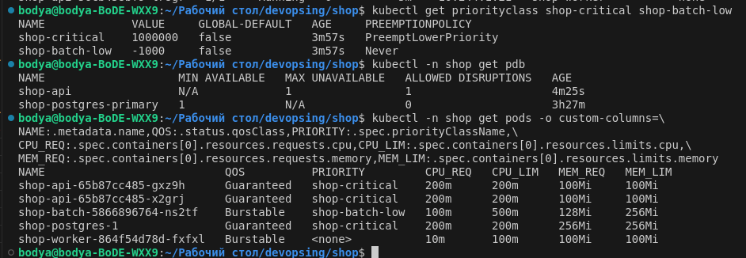

## Часть 6 — Pending и preemption

Планировщик смотрит на **requests**, а не на то, сколько процесс реально ест. Раздул batch: 5 реплик с request по 3 CPU. Часть сразу ушла в Pending: на нодах не хватает CPU. В событии ещё написано, что сам batch никого не вытеснит — у него `preemptionPolicy: Never`.

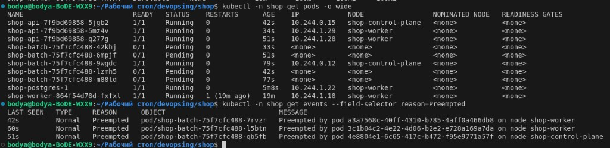

Чтобы поймать preemption, временно поднял api до трёх реплик по 2 CPU Guaranteed и выключил spread (иначе новая реплика могла бы уехать «ровно» и не врезаться в занятую ноду). Высокий `shop-critical` снял batch и сел на освободившееся место. Вытесненный batch снова стал Pending.


## Часть 7 — Давление по памяти

Kind по умолчанию почти выключает eviction по `memory.available`. Для опыта поднял порог на ноде (в итоге сработало с порогом порядка 11Gi — у kubelet «available» считается не так, как колонка в `free`).

У batch: request памяти 128Mi, limit 8Gi, процесс держал ~3.5Gi. То есть выше request, но ниже своего limit — cgroup его не душит, решает kubelet. Итог — **Evicted**. api и postgres (Guaranteed + высокий приоритет) остались Running.

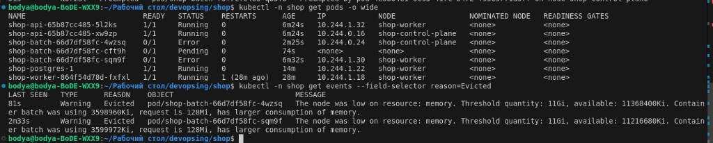

**Evicted** и **OOMKilled** — разный диагноз с похожим симптомом. Evicted пишет kubelet: ноде плохо, выбрал слабого. OOMKilled пишет ядро: контейнер пробил свой `limits.memory`.

## Часть 8 — SLA под нагрузкой

Сформулировал SLA так: при `hey -c 10` на `POST /order` **p95 не больше 400 мс**, ответов **5xx нет**. Batch при этом можно жертвовать — на заказной путь он не должен ронять цифры.

На Guaranteed 200m из krr при `-c 20` p95 уезжал к ~700 мс — cgroup режет CPU. Поднял api до Guaranteed **500m / 100Mi**. Финальный прогон на `-c 10`: p95 около **298–400 мс**, тысячи ответов `201`, пятерок нет.

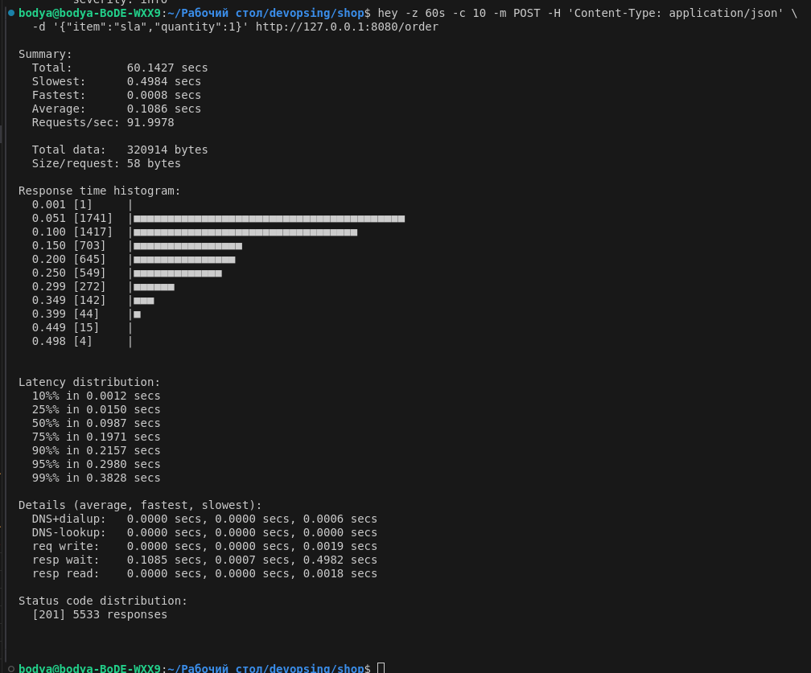

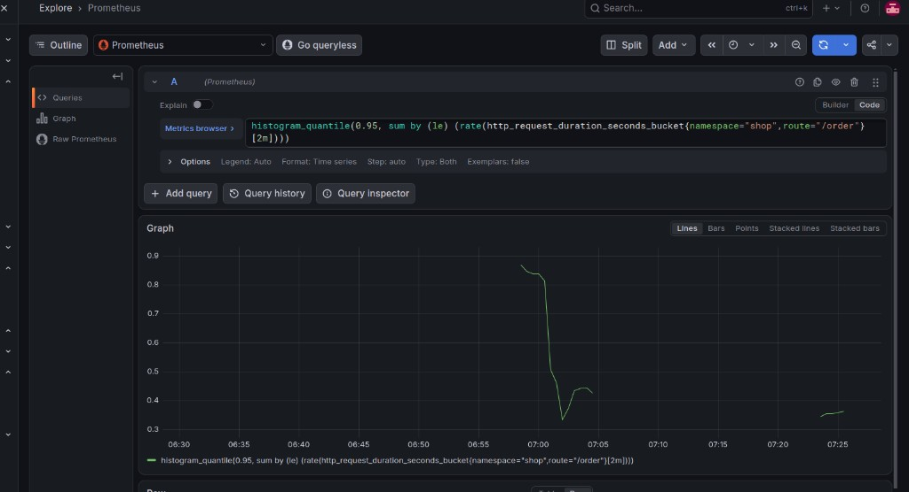

Пока гонял заказ, batch либо висел в Pending/Evicted из частей 6–7, либо тихо крутился с низким приоритетом — именно его и должна «отпускать» система первой.

## Часть 9 — Три алерта

В чарт добавил `PrometheusRule` (`templates/api-prometheusrule.yaml`) с меткой `release: monitoring`, чтобы стек из лабы 2 их подхватил. В правилах лежат **три** алерта:

1. **ShopOrderLatencyHigh** — p95 `POST /order` выше 400 мс дольше двух минут. Прямая граница SLA из части 8.
2. **ShopOrderErrorRateHigh** — доля 5xx на `/order` больше 1% за минуту. Вторая граница того же SLA: заказ может быть «быстрым», но битым.
3. **ShopBatchPending** — под `batch` минуту в `Pending`. Это не падение заказа, а сигнал, что фону не хватило места (после частей 6–7 такое ожидаемо).

По заданию достаточно поймать **firing хотя бы у одного**. Я спровоцировал третий: раздул request у batch, поды зависли в Pending, через минуту загорелся **ShopBatchPending**. Остальные два в этот момент были inactive — так и задумано.

Все три имени в манифесте:

```bash
kubectl -n shop get prometheusrule shop-api-alerts \
  -o jsonpath='{range .spec.groups[*].rules[*]}{.alert}{" — "}{.annotations.summary}{"\n"}{end}'
```

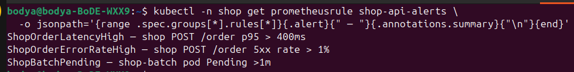

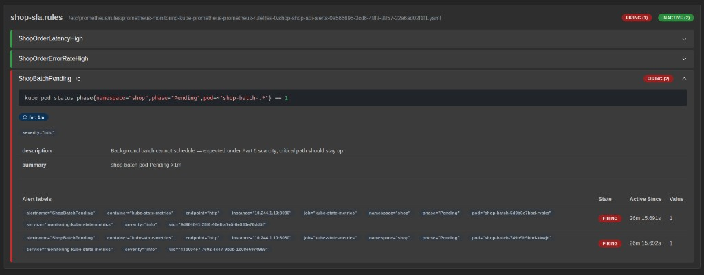

После снимка вернул batch к спокойным значениям в `values.yaml`.
