# Лаба 5. Плетём zero-trust сети вокруг сервиса

## 0. Выбор CNI

Я выбрал Cilium, так как он более производительный и предоставляет Hubble, который можно будет использовать для диагностики.

Для его установки я создал [кластер](src/kind-config.yaml) с выключенным CNI и двумя воркер-нодами с помощью Kind.

## 1. Развертывание Shop и исследование сети

После инициализации кластера установлен Cilium, CloudNativePG Operator, стек мониторинга из второй лабы и shop:

```bash
helm upgrade --install cilium \
  --namespace kube-system \
  oci://quay.io/cilium/charts/cilium \
  --version 1.20.4 \
  -f src/platform/cilium-values.yaml

helm upgrade --install cnpg \
  --namespace cnpg-system \
  --create-namespace \
  cnpg/cloudnative-pg \
  -f src/platform/cnpg-values.yaml

helm upgrade --install kps \
  --namespace monitoring \
  --create-namespace \
  oci://ghcr.io/prometheus-community/charts/kube-prometheus-stack \
  -f src/platform/lab2-stack/kube-prometheus-stack-values.yaml

helm upgrade --install loki \
  --namespace monitoring \
  oci://ghcr.io/grafana-community/helm-charts/loki \
  -f src/platform/lab2-stack/loki-values.yaml

helm upgrade --install alloy \
  --namespace monitoring \
  grafana/alloy \
  -f src/platform/lab2-stack/alloy-values.yaml

helm upgrade --install jaeger \
  --namespace monitoring \
  jaegertracing/jaeger \
  -f src/platform/lab2-stack/jaeger-values.yaml

helm upgrade --install shop \
  --namespace shop \
  --create-namespace \
  src/charts/shop
```

Можно посмотреть IP адреса подов:

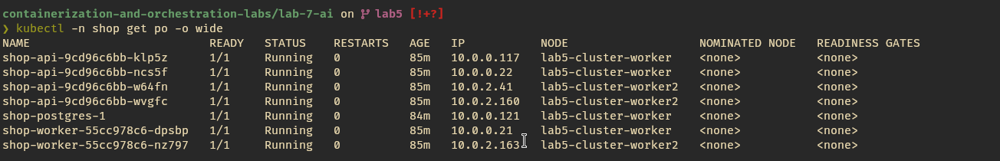

Если подключиться, например, к поду `shop-api-9cd96c6bb-klp5z`, можно посмотреть его IP адрес и eth0 изнутри:

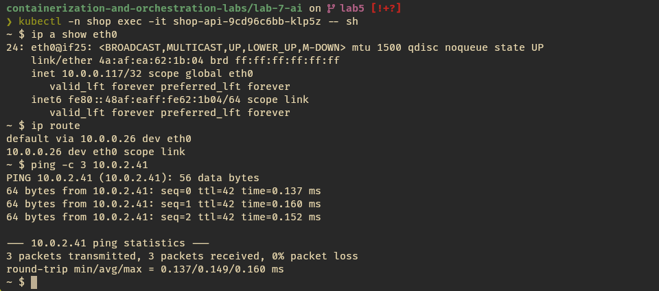

Из вывода `ip a show eth0` видно, что у eth0 ifindex 24, а @if25 - ifindex парного конца на ноде, IP-адрес пода совпадает с адресом из `kubectl -n shop get po -o wide`: 10.0.0.117/32, маршрут по умолчанию - 10.0.0.26. Под `shop-api-9cd96c6bb-w64fn`, запущенный на другой ноде доступен напрямую по IP-адресу.

Парный конец veth на ноде lab5-cluster-worker:

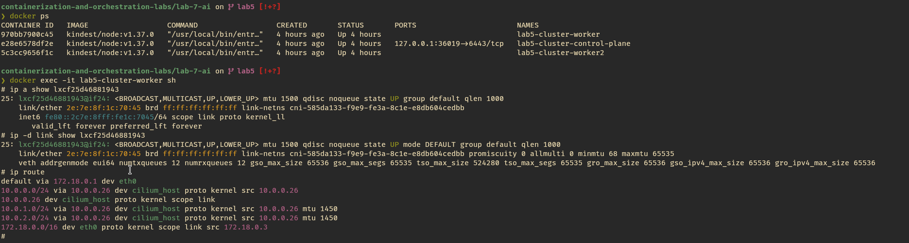

Тут видно, что у интерфейса ifindex 25, а у парного конца - 24, значит он образует veth-пару с eth0 пода.

## 2. Непрерывность через хаос подов

В шаблоне [api-service](src/charts/shop/templates/api-service.yaml) тип сервиса изменил на NodePort. NodePort открывает порт на всех нодах кластера, и kube-proxy перенаправляет трафик со всех нод по этому порту в сервис:

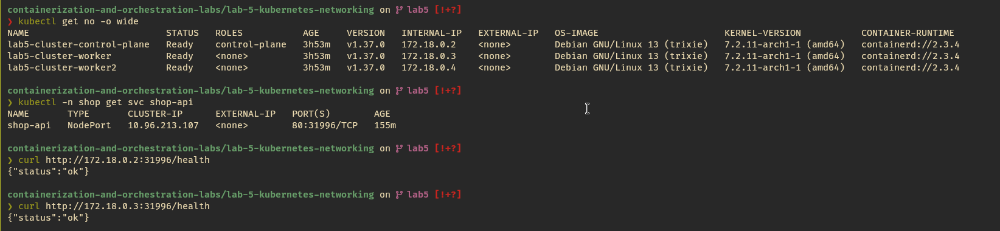

LoadBalancer - создает внешний балансировщик с публичным IP-адресом, который перенаправляет внешний трафик на под, но для работы ему нужна интеграция с облаком.
Headless Service - не создает виртуальный ClusterIP и отключает балансировку через kube-proxy, при DNS запросе напрямую возвращает IP-адреса подов.

Для удаления подов написан скрипт [chaos.sh](src/scripts/chaos.sh), который удаляет случайный под api или worker со статусом `Running`, спит 6 секунд, и повторяет это, пока ему не придет сигнал о завершении.

```bash
./src/scripts/chaos.sh
```

Нагрузка на сервис создавалась с помощью k6. В [скрипте k6](src/k6/load.js) используется один виртуальный пользователь, который отправляет запрос на `shop-api.shop.svc.cluster.local`, после чего спит 0.3 секунды. K6 запускается с помощью [джобы](src/k6/k6-job.yaml).

```bash
kubectl create cm k6-script --from-file=src/k6/load.js
kubectl apply -f src/k6/k6-job.yaml
```

K6 записывает метрики в prometheus с помощью remote write. На графике зеленая линия показывает RPS, а желтая - долю запросов с ошибками, за время тестирования не было запросов, завершившихся с ошибкой:

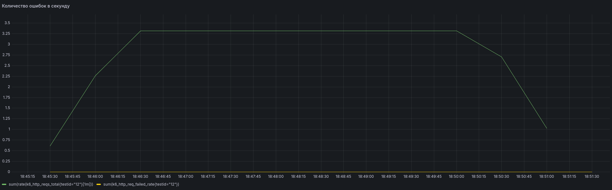

В кластере kube-proxy работает в режиме iptables:

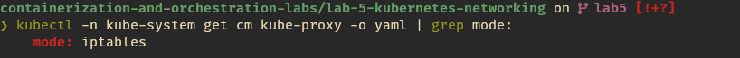

Сервис предоставляет ClusterIP, который не изменяется при перезапуске подов. IP-адреса живых подах содержатся в EndpointSlice. Kube-proxy создает правила iptables для перенаправления трафика от ClusterIP к подам. При запросе DNS превращает FQDN сервиса в ClusterIP. Дальше на основе правил iptables, IP-адрес получателя подменяется на IP-адрес пода.

Так как процесс обновления EndpointSlice и правил iptables выполняется с небольшой задержкой, могут возникать ошибки. При первых запусках теста небольшая часть запросов завершалась с ошибкой `error="dial: connection refused"` из-за того, что не удавалось установить TCP-соединение, так как под удалялся и приложение уже не слушало порт на IP-адресе, по которому отправлялся запрос. Чтобы это решить в шаблон [api](src/charts/shop/templates/api-deployment.yaml) добавлен preStop, который выполняет sleep 5s. С помощью этого поды успевают обработать все запросы перед удалением.

## 3. Матрица доступа

Перед настройкой сетевых политик описана матрица доступа:

| source\\dest             | api            | worker | postgres                 | CoreDNS              | Kube API Server         |
| ------------------------ | -------------- | ------ | ------------------------ | -------------------- | ----------------------- |
| api                      | -              | deny   | allow TCP 5432           | allow UDP 53, TCP 53 | deny                    |
| worker                   | deny           | -      | allow TCP 5432           | allow UDP 53, TCP 53 | deny                    |
| postgres                 | deny           | deny   | -                        | allow UDP 53, TCP 53 | allow TCP 443, TCP 6443 |
| prometheus               | allow TCP 8080 | deny   | deny                     | -                    | -                       |
| CloudNativePG            | deny           | deny   | allow TCP 8000, TCP 5432 | -                    | -                       |
| Клиенты и внешний трафик | allow TCP 8080 | deny   | deny                     | -                    | -                       |

## 4. Zero-trust сеть

Политики создаются с помощью [шаблонов](src/charts/shop/templates) в чарте shop. Политики [default-deny](src/charts/shop/templates/default-deny-networkpolicy.yaml) и [allow-dns](src/charts/shop/templates/allow-dns-networkpolicy.yaml) применяются ко всем сервисам. Для каждого сервиса сделан шаблон политики, который рендерит манифест на основе списков правил ingress и egress в [values](src/charts/shop/values.yaml). Дополнительно для api создана [CiliumNetworkPolicy api-nodeport](src/charts/shop/templates/api-nodeport-ciliumnetworkpolicy.yaml), которая разрешает входящий трафик из сущности world - без этого внешний трафик через NodePort не проходит. Для postgres задана [CiliumNetworkPolicy postgres-apiserver](src/charts/shop/templates/postgres-apiserver-ciliumnetworkpolicy.yaml), которая разрешает исходящий трафик к сущности kube-apiserver, так как это необходимо для работы кластера cnpg.

## 5. Проверка политик

Для проверки политик написан скрипт [test-policies.sh](src/scripts/test-policies.sh), который выполняет запросы между подами и сравнивает результат с ожидаемым. Результат выводится в виде таблицы:

| Источник   | Назначение       | Порт/протокол | Ожидаемо | Фактически |
| ---------- | ---------------- | ------------- | -------- | ---------- |
| api        | postgres         | 5432/TCP      | allow    | allow      |
| worker     | api              | 80/TCP        | deny     | deny       |
| worker     | postgres         | 5432/TCP      | allow    | allow      |
| postgres   | api              | 80/TCP        | deny     | deny       |
| Prometheus | api              | 8080/TCP      | allow    | allow      |
| client     | api              | 80/TCP        | allow    | allow      |
| client     | postgres         | 5432/TCP      | deny     | deny       |
| external   | api via NodePort | 31996/TCP     | allow    | allow      |

По таблице видно, что запросы работают в соответствии с матрицей доступа.

## 6. Поиск скрытой поломки связности

Я попросил AI-агента внести поломку. В Hubble по красной пунктирной линии на схеме сразу видно, что проблема происходит в postgres, а ниже видно, что все запросы api к postgres отбрасываются.

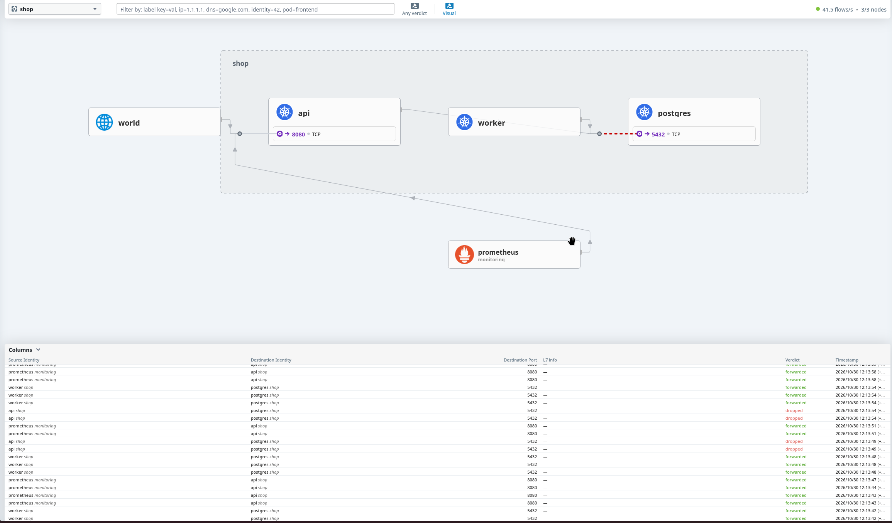

Скрипт для построения матрицы доступа дал такой же результат:

| Источник   | Назначение       | Порт/протокол | Ожидаемо | Фактически |
| ---------- | ---------------- | ------------- | -------- | ---------- |
| api        | postgres         | 5432/TCP      | allow    | deny       |
| worker     | api              | 80/TCP        | deny     | deny       |
| worker     | postgres         | 5432/TCP      | allow    | allow      |
| postgres   | api              | 80/TCP        | deny     | deny       |
| Prometheus | api              | 8080/TCP      | allow    | allow      |
| client     | api              | 80/TCP        | allow    | allow      |
| client     | postgres         | 5432/TCP      | deny     | deny       |
| external   | api via NodePort | 31996/TCP     | allow    | allow      |

Дальше я просто посмотрел политику postgres в формате yaml:

```bash
kubectl -n shop get networkpolicies shop-postgres -o yaml
```

Как оказалось, проблема в том, что в конфигурации ingress в политике postgres указан неверный лейбл, по которому выбираются поды api. После исправления с `app: api` на `app.kubernetes.io/name: api` и запуска `helm upgrade` запросы перестали отбрасываться, это видно в интерфейсе Hubble:

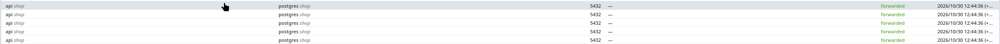

## 7. Мониторинг

Для метрик в [cilium-values.yaml](src/platform/cilium-values.yaml) указаны метрики, которые отдает Hubble. ServiceMonitor добавлен в чарт shop. На основе этих метрик построен [дашборд в Grafana](src/dashboard.json):

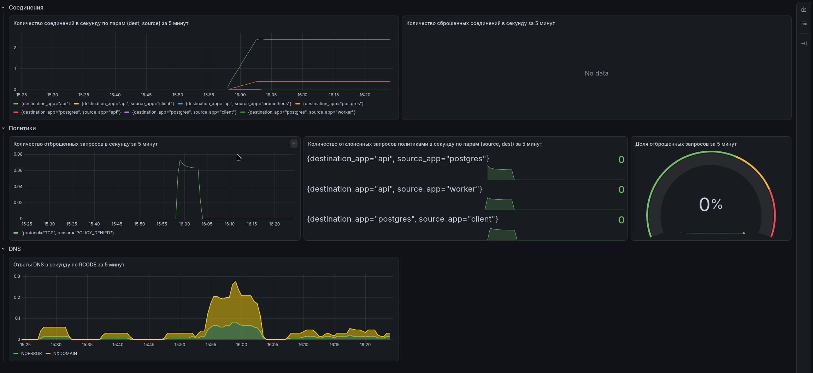

На дашборде присутствуют графики соединений, политик и DNS. Для DNS вместо метрик Hubble использовались метрики CoreDNS, так как в лабе не использовались L7 правила cilium для DNS.

С помощью [PrometheusRule](src/charts/shop/templates/network-prometheusrule.yaml) реализованы 3 алерта:

- `ShopAllowedPathDenied` - трафик по самым важным маршрутам блокируется политиками в течение 10 минут
- `ShopTcpReset` - TCP соединения сбрасываются в течение 10 минут
- `ShopDnsServerFailure` - DNS возвращает ошибки SERVFAIL в течение 10 минут

Можно изменить пролитики, чтобы трафик с api в postgres заблокировался. Тогда алерт сначала перейдет в статус Pending:

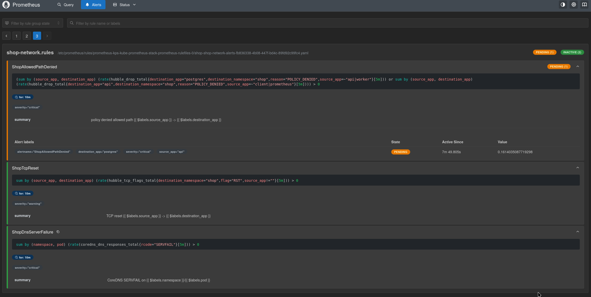

После 10 минут ожидания алерт перейдет в статус Firing и появится в alertmanager:

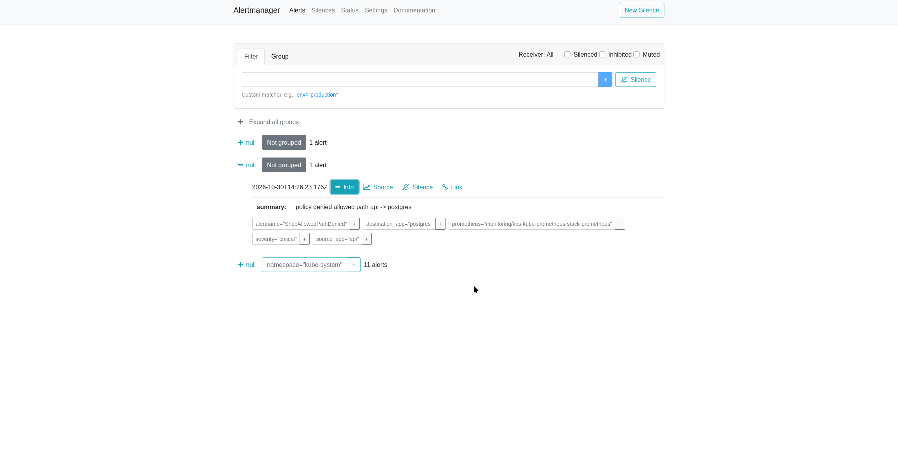
