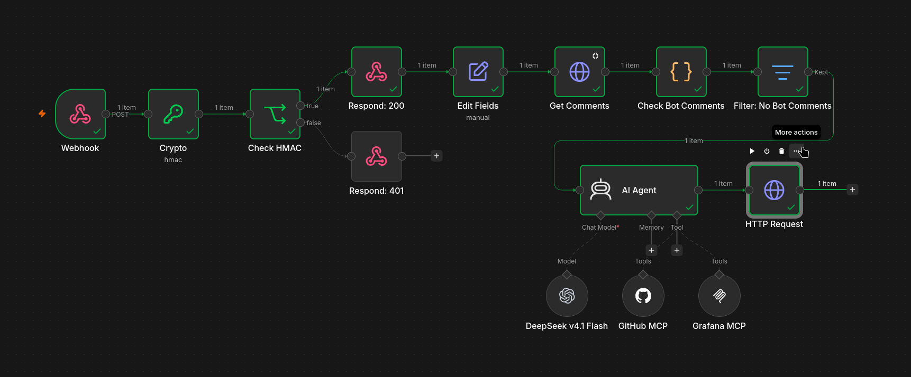
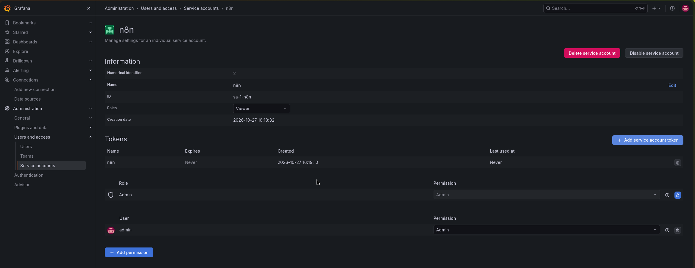
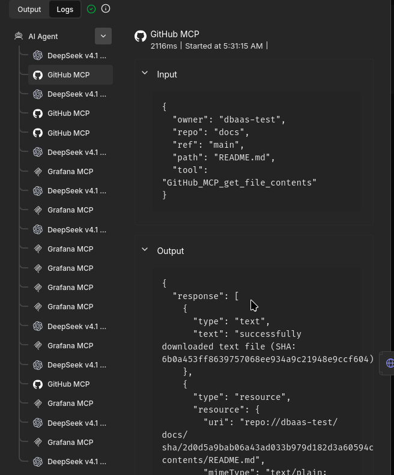
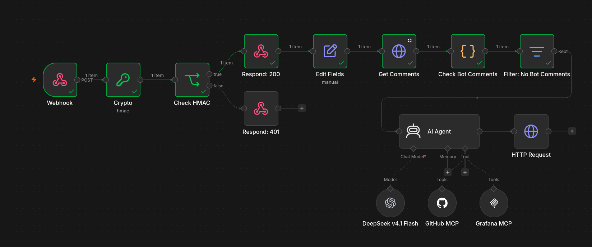
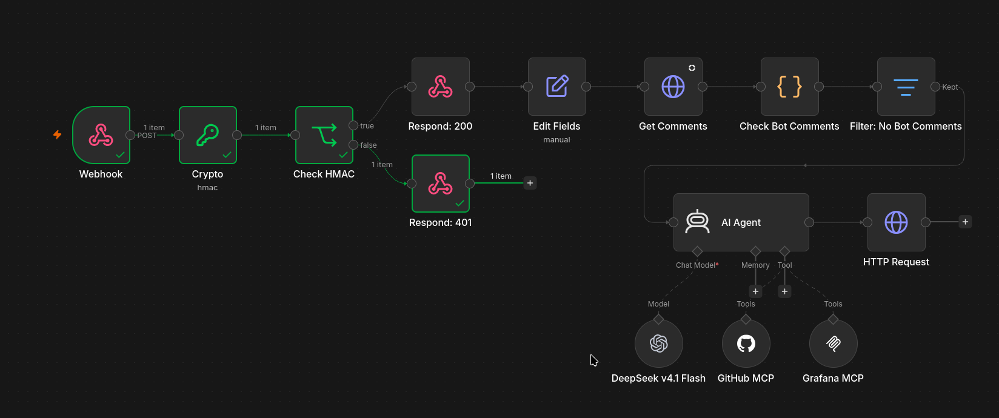
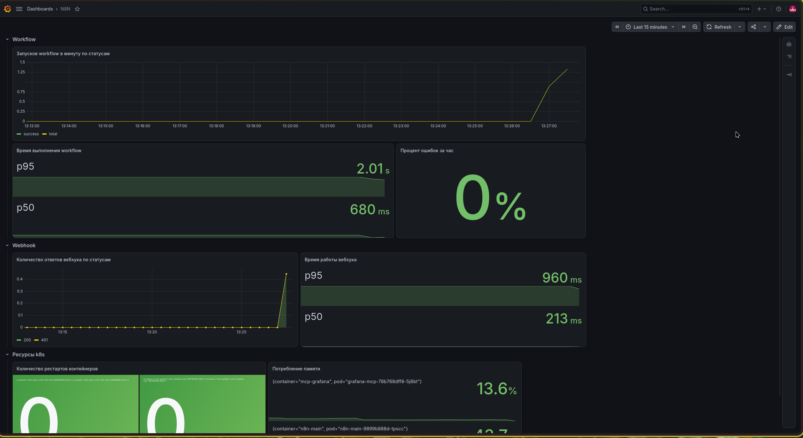
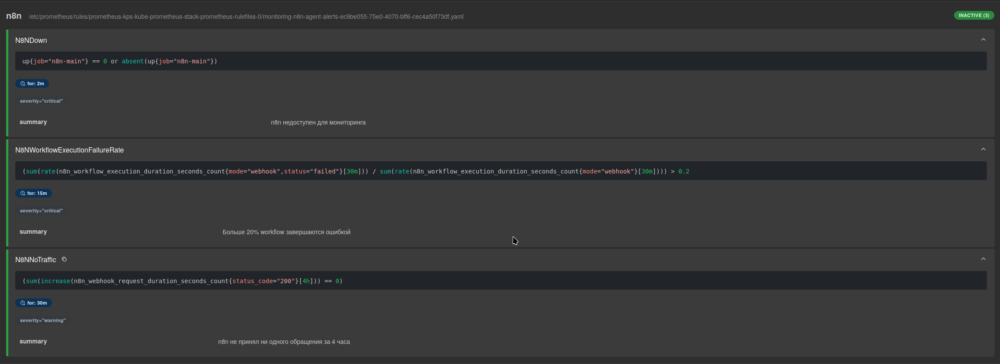

# Лаба 7. Как приручить агента?

## 1. Кейс

В крупной IT-компании команда DBaaS предоставляет пользователям (другим командам) техподдержку. SRE-инженеры отвечают за поддержку по эксплуатации СУБД, для каждого вида СУБД в платформе назначается дежурный, который обрабатывает поступающие обращения. Для наиболее распространенных СУБД, таких как Postgres, ежедневно поступает огромное количество обращений и для первичной диагностики инженер должен вручную проверять логи и метрики для каждой базы данных, а также искать информацию в документации и ранбуках.

Автоматизация первичного анализа обращений в техподдержку. Триггер: создание обращения. Из текста обращения workflow извлекает информацию от пользователя. После этого агент выполняет поиск информации, связанной с обращением, в документации и идет в систему мониторинга за логами и метриками БД для анализа. На последнем шаге workflow выполняет анализ и публикует его в понятном для человека виде в комментариях к обращению. Если данных недостаточно, бот задает пользователю уточняющие вопросы.

Такая автоматизация помогает экономить время дежурному инженеру и пользователям: часть обращений может быть закрыта пользователями, так как ответ уже есть в документации, и обращение не требует участия инженера; а в остальных случаях инженер будет быстрее погружаться в контекст.

## 2. Реализация Workflow

[Итоговый workflow](src/dbaas-support-bot.json):



### Шаги Workflow

1. Webhook-триггер - уведомления о событиях issues
2. Crypto - создание HMAC для тела запроса
3. If - проверка подлинности запроса по HMAC с ветвлением
4. Respond to Webhook - отправка HTTP ответа
   4.1 если HMAC из прошлого шага совпадает с HMAC из запроса, возвращает 200 и продолжает работу
   4.2 если не совпадает, отправляет 401 и завершает Workflow
5. Edit Fields - извлечение используемых полей из запроса для более удобного использования
6. HTTP Request - получение списка комментариев к issue
7. Code - проверка того, обрабатывал ли бот обращение раньше
8. Filter - фильтрация обращений, которые уже были обработаны
9. AI Agent - анализ обращения:
   9.1 OpenAI Chat Model - DeepSeek v4.1 Flash из polza.ai
   9.2 GitHub MCP - поиск документации в репозитории
   9.3. MCP Client Tool - локальный Grafana MCP для проверки логов и метрик БД
10. HTTP Request - публикация комментария к issue

### AI toolkit

#### GitHub MCP

##### 1. `search_code` - поиск по содержимому файлов

Принимает параметры:

- `fields (string[], optional)` - список полей, которые нужно вернуть в результате поиска, если не указать, возвращаются все поля;
- `order (string, optional)` - порядок сортировки;
- `page (number, optional)` - номер страницы для пагинации;
- `perPage (number, optional)` - количество результатов на страницу для пагинации;
- `query (string, required)` - поисковый запрос по содержимому файлов, неявно использует AND, поддерживает OR, NOT и "текст в кавычках" для точного совпадения, также есть квалификаторы: `repo:owner/repo`, `org:`, `user:`, `language:` и др.;
- `sort (string, optional)` - поле для сортировки, поддерживается только значение `indexed`.

##### 2. `get_file_contents` - возвращает содержимое файла

Принимает параметры:

- `fields (string[], optional)` - список полей, которые нужно вернуть в результате, если не указать, возвращаются все поля;
- `owner (string, required)` - владелец репозитория (пользователь или организация);
- `path (string, optional)` - путь к файлу/директории;
- `ref (string, optional)` - git ref, например, `refs/tags/{тег}`, `refs/heads/{ветка}` или `refs/pull/{номер PR}/head`;
- `repo (string, required)` - название репозитория;
- `sha (string, optional)` - хеш коммита.

#### Grafana MCP

##### 1. `list_prometheus_metric_metadata` - получение списка метрик с метаданными

Принимает параметры:

- `datasourceUid (string, required)` - идентификатор Datasource;
- `limit (number, optional)` - максимальное количество метрик, которое вернется в ответе;
- `limitPerMetric (number, optional)` - максимальное число записей на метрику;
- `metric (string, optional)` - название метрики;
- `projectName (string, optional)` - имя проекта GCP (только для облачного мониторинга)

##### 2. `query_prometheus` - запрос к метрикам

Принимает параметры:

- `datasourceUid (string, required)` - идентификатор Datasource;
- `endTime (string, required)` - конец интервала;
- `expr (string, required)` - PromQL запрос;
- `projectName (string, optional)` - имя проекта GCP (только для облачного мониторинга)
- `queryType (string, optional)` - тип запроса, 'range' или 'instant'
- `startTime (string, optional)` - начало интервала, обязательный аргумент при использовании range запросов;
- `stepSeconds (number, optional)` - время между измерениями в секундах, работает только для range запросов.

##### 3. `query_loki_logs` - запрос к логам

Принимает параметры:

- `datasourceUid (string, required)` - идентификатор Datasource;
- `direction (string, optional)` - направление запроса: "forward" (сначала старые логи) или "backward" (сначала новые, значение по умолчанию);
- `endRfc3339 (string, optional)` - конец интервала запроса в формате RFC3339 или относительное время (например, "now");
- `format (string, optional)` - формат вывода;
- `limit (number, optional)` - максимальное количество строк логов, которое вернется в ответе;
- `logql (string, required)` - LogQL запрос;
- `queryType (string, optional)` - тип запроса, 'range' или 'instant'
- `startRfc3339 (string, optional)` - начало интервала;
- `stepSeconds (number, optional)` - шаг временного диапазона.

### Skill агента

[Системный промпт](./SKILL.md) агента содержит описание его роли, краткое описание окружения, правила работы с документацией и ограничения для агента.
Также в нем указан алгоритм работы агента:

1. Определение типа обращения.
2. Поиск документации по теме обращения.
3. Поиск инстанса БД в системе мониторинга.
4. Диагностика.
5. Анализ.

Формат ответа модели - готовый комментарий к Issue в Markdown.

## 3. Запускаем локально

### 0. GitHub App

Для демонстрации в GitHub создана организация, для нее сгенерированы 2 репозитория:

1. [dbaas-test/docs](https://github.com/dbaas-test/docs) - содержит документацию
2. [dbaas-test/support](https://github.com/dbaas-test/support) - содержит шаблон issues

Для работы с API GitHub нужно создать GitHub App и настроить его права на репозитории. В workflow понадобится read-only доступ к repository contents для чтения документации и read and write доступ к issues.

Во вкладке Credentials нужно сгенерировать и сохранить приватный ключ и client secret, их нужно будет указывать в нодах N8N для аутентификации. Также при аутентификации в GitHub MCP N8N предложит OAuth redirect URL, который нужно будет указать в настойках GitHub App.

Еще в GitHub App можно настроить отправку событий issues на вебхук, но в лабораторной работе будет использоваться curl.

После настройки нужно установить GitHub App и выбрать репозитории, к которым у него будет доступ.

### 1. Подготовка окружения

Для лабораторной используется локальный кластер Kubernetes с одной нодой, [развернутый с помощью Kind](src/kind-config.yaml). Для подготовки окружения используются helm-чарты. Их конфигурации расположены в src/helm.

Для мониторинга нужно установить 3 чарта: kube-prometheus-stack, loki и alloy. Установка выполнена аналогично второй лабораторной работе. Еще для тестирования workflow понадобится CloudNativePG Operator и тестовая БД с мониторингом. Манифесты для БД и PodMonitor для сбора метрик: [postgres.yaml](src/postgres.yaml).

### 2. Установка Grafana MCP

Перед установкой Grafana MCP сервера нужно залогиниться в Grafana, создать сервисный аккаунт с правами на чтение и выпустить токен:



Токен нужно скопировать и после этого создать секрет:

```bash
kubectl -n agent create secret generic grafana-mcp \
  --from-literal=api-key="$(wl-paste)" \
  --from-literal=server-token="$(openssl rand -hex 32)"
```

api-key будет использоваться для получения доступа к Grafana, а server-token для подключения к MCP серверу в N8N.

После этого можно установить чарт:

```bash
helm install grafana-mcp oci://ghcr.io/grafana-community/helm-charts/grafana-mcp -n agent -f src/helm/grafana-mcp-values.yaml
```

### 3. Установка N8N

Для N8N тоже есть Helm-чарт. В его репозитории есть [пример конфигурации в Standalone режиме](https://github.com/n8n-io/n8n-hosting/blob/v1.17.0/charts/n8n/examples/standalone.yaml) для локального тестирования различных workflow. Пример содержит готовую команду для создания секретов, необходимых для работы N8N:

```bash
kubectl -n agent create secret generic n8n-secrets \
  --from-literal=N8N_ENCRYPTION_KEY=$(openssl rand -hex 32) \
  --from-literal=N8N_HOST=localhost \
  --from-literal=N8N_PORT=5678 \
  --from-literal=N8N_PROTOCOL=http
```

После этого можно установить сам чарт:

```bash
helm install n8n oci://ghcr.io/n8n-io/n8n-helm-chart/n8n -n agent --version 1.17.0 -f src/helm/n8n-values.yaml
```

### 4. Настройка Workflow

#### 1. Триггер

Так как Webhook не поддерживает аутентификацию через HMAC, для него нужно задать дополнительные параметры, чтобы при выполнении ноды ответ возвращался не сразу, а в отдельной ноде, а также нужно передавать в следующий шаг тело запроса в бинарном формате. Кроме этого можно сразу добавить фильтрацию по типам событий, для которых можно не запускать Workflow. Параметры Webhook:

| Параметр       | Значение                                                                               |
| -------------- | -------------------------------------------------------------------------------------- |
| Authentication | None                                                                                   |
| Respond        | Using 'Respond to Webhook' Node                                                        |
| Only Run If    | `{{ $json.headers["x-github-event"] === "issues" && $json.body.action === "opened" }}` |
| Raw Body       | True                                                                                   |

#### 2. Аутентификация

В ноде Crypto нужно указать Hmac Secret. Далее этот секрет нужно указать в настройках вебхука GitHub App, но так как для тестирования будет использоваться curl, это не требуется.

#### 3. Извлечение полей

Для более удобного использования в следующих шагах в ноде Edit Fields из запроса извлекаются поля:

- `issue_number` - номер issue
- `issue_title` - заголовок
- `issue_body` - текст обращения
- `issue_url` - ссылка на issue
- `repository` - полное название репозитория в формате owner/repo

#### 4. Проверка на повторную обработку

Для доступа к API GitHub можно использовать `Predefined Credential Type` с типом `GitHub App API`. В настройках кредов нужно указать App ID, Installation ID и приватный ключ. Позже эти креды можно будет переиспользовать при публикации комментария.

Проверка повторной обработки нужна, так как GitHub гарантирует доставку событий at-least-once. Самый простой способ сделать минимальную проверку - проверить, отвечал ли уже бот в комментариях.

Для получения списка комментариев выполняется GET запрос к `https://api.github.com/repos/<repository>/issues/<issue_number>/comments`.

Результат обрабатывается в ноде с JS кодом:

```js
const appName = "dbaas-support-agent[bot]";

const alreadyReplied = $input
  .all()
  .some((comment) => comment.json.user.login === appName);

return [
  {
    json: {
      already_replied: alreadyReplied,
    },
  },
];
```

После этого нода `Filter` останавливает workflow, если бот уже отвечал на обращение.

#### 5. Настройка агента

Модель подключалась по [инструкции](https://polza.ai/docs/integracii/n8n) с сайта провайдера.

Для Grafana MCP нужно включить Bearer Auth и указать server-token из секрета grafana-mcp в kubernetes.

Для подключения к GitHub MCP нужно указать Client ID и Client Secret, а также в настройках GitHub App добавить OAuth Redirect URL, указанный в N8N. После этого можно будет залогиниться через GitHub. Еще оказалось, что из России GitHub MCP не работает, так что пришлось временно менять страну.

В параметрах MCP серверов можно ограничить инструменты, которые будут доступны агенту, чтобы он использовал только то, что нужно.

После этого в системный промпт агента добавлен текст из [SKILL.md](SKILL.md), а в пользовательский промпт добавлены тема и текст обращения. Пользовательский промпт:

```
Тема обращения:
{{ $('Edit Fields').item.json.issue_title }}

Описание обращения:
{{ $('Edit Fields').item.json.issue_body }}
```

#### 6. Публикация комментария

Комментарий публикуется не через MCP, чтобы у инструментов агента был только read-only доступ к репозиторию и системе мониторинга. POST запрос отправляется на `https://api.github.com/repos/<repository>/issues/<issue_number>/comments`. В теле запроса отправляется вывод модели:

```
{{
  { body: $json.output }
}}
```

#### 7. Проверка Workflow

Для проверки сгенерировано [обращение](src/testdata/issue.json).

Первое обращение - зависший запрос. Для воспроизведения нужно подключиться к базе и выполнить запрос с долгим sleep.

```bash
PASSWORD=$(kubectl -n dbaas get secrets pg-test-app -o jsonpath='{.data.password}' | base64 -d)

kubectl exec -n dbaas pg-test-1 -c postgres --env="PGPASSWORD=$PASSWORD" -- sh -c '
  psql -h 127.0.0.1 -U app -d app -c "select pg_sleep(3600)"
' &
```

После этого нужно опубликовать issue и отправить уведомление на вебхук N8N:

```bash
SECRET='secret'
SIG="sha256=$(openssl dgst -sha256 -hmac "$SECRET" src/testdata/issue.json | awk '{print $2}')"

curl -X POST http://localhost:5678/webhook-test/github-issue \
  -H 'Content-Type: application/json' \
  -H 'X-GitHub-Event: issues' \
  -H "X-Hub-Signature-256: $SIG" \
  --data-binary @src/testdata/issue.json
```

После небольшого дебага workflow заработал и агент ответил в [issue](https://github.com/dbaas-test/support/issues/2#issuecomment-6459020167).

В логах агента можно посмотреть, что он несколько раз вызывал инструменты GitHub MCP и Grafana MCP:



При повторном запуске с тем же запросом workflow не доходит до запуска агента:



Если отправить запрос без заголовка `X-Hub-Signature-256`, workflow вернет ошибку 401:



## 4. Мониторинг

В Grafana настроен дашборд с тремя строками:

- workflow - графики статусов и времени выполнения workflow, процент ошибок
- Webhook - графики ответов вебхука по статусам и времени работы вебхука
- Ресурсы K8s - количество перезапусков контейнеров, потребление памяти, статусы контейнеров

Дашборд:



Добавлены [3 алерта](src/alerts/n8n-alerts.yaml):



- N8NDown - нужен для того, чтобы реагировать в тот момент, когда N8N не отдает метрики
- N8NWorkflowExecutionFailureRate - если возрастает число запусков workflow, завершившихся с ошибкой, нужно проверить, в чем именно причина ошибок
- N8NNoTraffic - по условиям кейса должно быть много запросов, если долго не происходит запуск workflow, значит есть какая-то проблема
